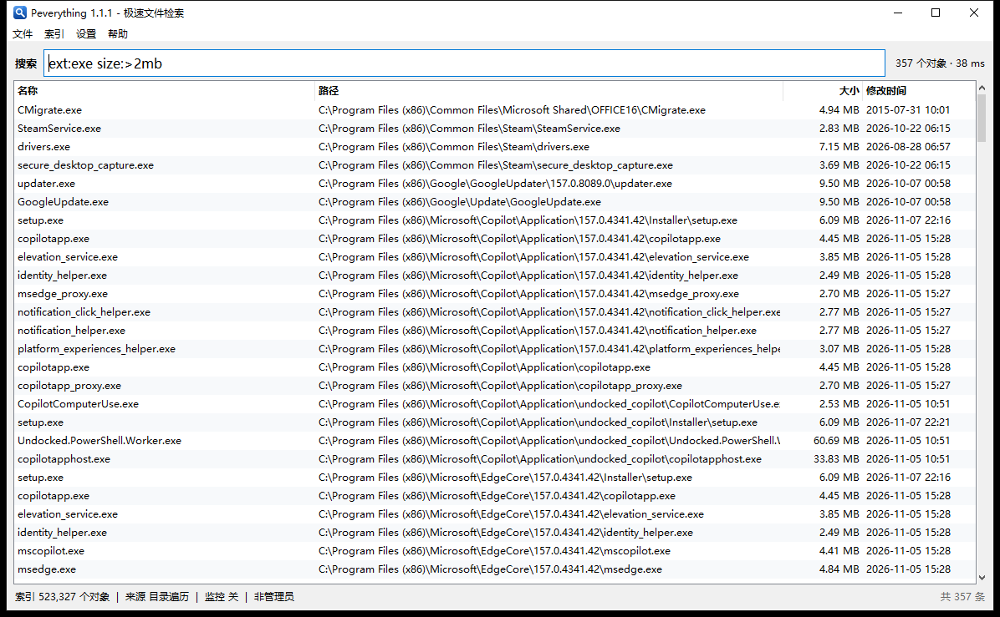

# Peverything

用 Python 从零实现的 **Everything**：直接读取 NTFS 的 MFT（主文件表）建立索引，
在一两秒内索引几十万个文件名，之后每次检索都在内存里完成，典型耗时 **10~100 ms**。

纯标准库，零第三方依赖，Windows 10/11 + Python 3.10 即可运行；命令行和图形界面都有。

```
$ pev search "report ext:pdf size:>1mb"
D:\work\季度报告\report_2024.pdf
D:\work\季度报告\report_2025.pdf
共 2 条结果，用时 2 ms（索引 523,327 个对象）
```



---

## 目录

- [它和 Everything / Jeverything 的关系](#它和-everything--jeverything-的关系)
- [快速开始](#快速开始)
- [搜索语法](#搜索语法)
- [命令行参考](#命令行参考)
- [图形界面](#图形界面)
- [工作原理](#工作原理)
- [性能实测](#性能实测)
- [权限与降级策略](#权限与降级策略)
- [已知限制](#已知限制)
- [项目结构](#项目结构)
- [测试](#测试)
- [打包成 exe](#打包成-exe)
- [后续可以做的事](#后续可以做的事)

---

## 它和 Everything / Jeverything 的关系

Everything 之所以快，是因为它**不遍历目录**，而是直接问 NTFS 要"这个卷上有哪些
文件名"。这个思路是公开的：`FSCTL_ENUM_USN_DATA` 一次就能吐出整张 MFT，
`FSCTL_READ_USN_JOURNAL` 则能拿到"刚刚发生了什么变化"。

本项目按同样的原理重新实现了一遍：

| 能力 | Everything（C++） | Jeverything（Java 移植） | **Peverything（本仓库）** |
| --- | --- | --- | --- |
| MFT 直读建索引 | ✅ | ✅ | ✅ `peverything/usn.py` |
| USN 日志实时更新 | ✅ | 部分 | ✅ `peverything/watcher.py` |
| 非 NTFS / 无管理员降级 | ✅ | 有限 | ✅ 多线程 `os.scandir` 兜底 |
| 毫秒级子串检索 | ✅ | ✅ | ✅ 连续 blob + `bytes.find` |
| Everything 风格查询语法 | ✅ | 部分 | ✅ 常用子集 |
| 图形界面 | ✅ 原生 Win32 | Swing | ✅ Tkinter（无依赖，带托盘与全局热键） |
| 命令行 | 有限 | 无 | ✅ `scan/search/info/watch/gui` |
| 依赖 | — | JVM | **仅 Python 标准库** |

代码是独立实现的，没有复制 Jeverything 或 Everything 的源码；参考的只是"读 MFT +
读 USN 日志"这个公开的工程思路。Jeverything 用 Java 做过的那些取舍（例如如何在
没有管理员权限时退化成目录遍历），本项目也按 Python 的实际情况重新做了一遍。

## 快速开始

```bat
:: 1. 建索引（普通权限下走目录遍历，管理员权限下走 MFT 直读）
python -m peverything scan

:: 2. 检索
python -m peverything search "kernel32"
python -m peverything search "ext:log size:>10mb" --long
python -m peverything search "*.pdf dm:thisyear" -n 50

:: 3. 图形界面
python -m peverything gui

:: 4. 实时监控（需要管理员）
python -m peverything watch --apply
```

也可以装成命令：

```bat
pip install -e .
pev scan
pev search "report"
```

或者直接双击仓库根目录的 `pev.bat` / `Peverything.bat`（后者以 `pythonw` 启动，
不弹黑框）。

想给别人用、或者机器上没装 Python，就打包成独立 exe：

```bat
python -m pip install pyinstaller
python tools\build_exe.py
dist\Peverything.exe
```

详见[打包成 exe](#打包成-exe)。

索引默认保存在 `%LOCALAPPDATA%\Peverything\index.pev`，可用 `-o` 或环境变量
`PEVERYTHING_INDEX` 指定。

## 搜索语法

| 写法 | 含义 | 例子 |
| --- | --- | --- |
| `foo bar` | 同时包含（AND） | `report 2024` |
| `foo\|bar` | 或者（OR，按段拆分整个查询） | `jpg\|png` |
| `!foo` | 排除 | `!node_modules` |
| `"foo bar"` | 引号内按字面匹配 | `"setup log"` |
| `*` `?` | 通配符（匹配整条路径） | `*.dll`、`report_????.pdf` |
| `ext:py;js` | 扩展名列表（`;` 或 `,` 分隔） | `ext:mp4;mkv` |
| `path:temp` | **目录部分**包含 | `path:AppData` |
| `nopath:readme` | 只匹配**文件名** | `nopath:todo` |
| `wfn:*.txt` | 整个文件名做通配符匹配 | `wfn:a*.docx` |
| `regex:^\w+_\d+` | 正则（按单条路径匹配，默认忽略大小写） | `regex:\d{4}\.log$` |
| `size:>10mb` | 大小：`>` `<` `>=` `<=` `=` `a..b` | `size:1kb..1mb` |
| `dm:today` | 修改日期：`today` `yesterday` `thisweek` `thismonth` `thisyear` `2024` `2024-05` `2024-05-01` `A..B` | `dm:2024-01-01..2024-06-30` |
| `dc:` `da:` | 暂按 `dm:`（修改时间）处理并给出提示 | `dc:2024` |
| `file:` `folder:` | 只看文件 / 只看文件夹 | `folder:cache` |
| `parent:C:\Windows` | 父目录正好是 | `parent:C:\Windows` |
| `case:` | 打开区分大小写（可写成 `case:关键词`） | `case:README` |

说明：

- 默认大小写不敏感。实现方式是把路径做 **ASCII 折叠**（`bytes.lower()`，只处理
  A-Z），因此中英文混排、UTF-8 多字节字符都能正确检索，且检索副本与原路径**字节
  长度完全一致**，可以共用一张偏移表。
- 通配符和正则都只在**单条路径内**匹配，不会跨文件。
- `size:` / `dm:` 需要索引里带有文件大小和时间；MFT 直读建立的索引不含这两项
  （MFT 枚举本身不返回），此时命令会明确提示，而不是悄悄返回空结果。

## 命令行参考

```text
pev scan   [目录...] [-v C,D] [--method auto|mft|walk] [-o 索引] [--exclude 模式]
           [--elevate] [--workers N] [--quiet]
pev search <查询> [-n 数量] [--sort name|path|size|time] [--reverse] [--json]
           [--long] [--files-only|--dirs-only] [--count-only] [--open|--reveal]
pev info   [-o 索引] [--json]
pev watch  [-v C,D] [-o 索引] [--apply] [--interval 秒]
pev gui    [-o 索引] [--query 预填搜索词]
```

`scan` 的三种模式：

- `--method mft`：只读 MFT，最快，需要管理员 + NTFS，索引不含大小/时间。
- `--method walk`：多线程 `os.scandir`，任何权限/文件系统都能用，索引含大小/时间；
  `--exclude "模式"` 可跳过匹配的目录（只在此模式生效）。
- `--method auto`（默认）：管理员且是 NTFS 就走 MFT，否则自动降级为遍历；
  MFT 直读过程中出现任何异常也会在 auto 模式下退回遍历，不会让整次扫描失败。

`scan --elevate` 会通过 UAC 重新启动自己，拿到管理员权限后直接建 MFT 索引。

退出码：`0` 成功，`1` 出错（无索引、查询语法错误等），`2` 没有匹配结果。

## 图形界面

`pev gui` 打开一个 Everything 风格的窗口：

- 顶部搜索框，输入即搜（120 ms 防抖），底部状态栏显示对象数、索引来源、监控状态；
- 列表按 名称 / 路径 / 大小 / 修改时间 排序（点表头切换升降序）；
- 双击打开文件，`Ctrl+Enter` 在资源管理器中定位，`Alt+Enter` 查看 Windows 属性，`Ctrl+C` 复制路径；
- 右键菜单、导出 CSV、`F5` 重扫、`Esc` 清空；
- 管理员运行时自动开启 USN 实时监控，文件变化会在后台增量并入索引（不重建索引）；
- 单次最多显示 5000 条，超出会在标题栏提示。

菜单「索引 → 以管理员身份重启」可一键提权，换取 MFT 直读 + 实时监控。

### 常驻后台：全局热键 + 托盘

和 Everything 一样，关掉窗口不等于退出：

- **全局热键** `Ctrl+Alt+E`（可改）在任何程序里按下，都能显示 / 隐藏窗口；
- 关闭窗口（X）默认**最小化到托盘**，程序继续在后台监听热键、监控文件变化；
- 托盘图标：左键单击 / 双击唤出窗口，右键菜单有「显示 / 打开索引所在目录 / 退出」；
- **单实例**：已经有一份在后台时，再双击 `Peverything.exe` 只会把已有窗口叫到前面，不会再开一份；
- 第一次隐藏到托盘时会弹一个气泡提示，告诉你还在后台、怎么叫回来。

「设置 → 首选项 ...」（`Ctrl+,`）里可以改：

| 选项 | 说明 |
| --- | --- |
| 全局热键 | 例如 `Ctrl+Alt+E`、`Win+Shift+F`、`F9`；清空即关闭热键 |
| 关闭窗口时 | 最小化到托盘 / 最小化到任务栏 / 退出程序 |
| 在通知区域显示图标 | 关掉后 x 只能最小化到任务栏 |

设置保存在 `%LOCALAPPDATA%\Peverything\settings.json`。

> 新版 Windows 会把新注册的托盘图标放进「隐藏的图标」溢出区（`Shell_NotifyIconGetRect`
> 返回 `S_FALSE` 就是这个状态），把图标从溢出区拖到任务栏上固定一下即可一直可见；
> 热键不受影响。

## 工作原理

### 1. 建索引：直接读 MFT

```
CreateFileW("\\.\C:")                → 卷句柄（需要管理员）
FSCTL_QUERY_USN_JOURNAL              → 拿到当前 NextUsn
FSCTL_ENUM_USN_DATA  (循环 1 MiB/次) → 每条 USN_RECORD_V2：
    FileReferenceNumber / ParentFileReferenceNumber / FileName / FileAttributes
```

`USN_RECORD_V2` 是 60 字节定长头 + UTF-16LE 文件名，用 `struct` 在 `bytes` 上直接
解析，百万条记录几秒内读完。

拿到的是"名字 + 父目录的 file reference"，不是完整路径，所以要重建目录树：

- 以根目录 FRN=5 为起点，`{FRN: 完整目录路径}` 做缓存；
- 每条记录先查缓存，未命中就沿 `ParentFileReferenceNumber` 向上走，走到已知目录后
  把整条链一次性填进缓存（记忆化），因此整体是 O(n)；
- 父目录不存在 / 父不是目录 / 环（最多 512 层）→ 丢弃该记录，不会死循环；
- `$MFT` `$Bitmap` `$Extend` 等 NTFS 元数据文件在根目录下被过滤掉。

非 NTFS（FAT32/exFAT/网络盘）或没有管理员权限时，退化成多线程 `os.scandir` 遍历，
并跳过符号链接/联接点（`FILE_ATTRIBUTE_REPARSE_POINT`）避免成环。

### 2. 存索引：一条大 blob

```
data      = b"C:\\Windows\\System32\\a.dll\nC:\\Windows\\b.exe\n..."   # 原样
low       = data.lower()                                              # ASCII 折叠
offsets   = uint32[n+1]     每条路径在 blob 里的起止
attrs     = uint32[n]       文件属性（是否目录等）
sizes     = int64[n]        文件大小（walk 模式才有）
mtimes    = int64[n]        修改时间（walk 模式才有）
```

- 路径之间用 `\n` 分隔（Windows 文件名不允许换行，天然安全）；
- `bytes.lower()` 只改 A-Z，所以 `low` 与 `data` **长度逐字节相同**，共用一张
  `offsets`，省一半内存；
- 落盘时 zlib 压缩（路径之间高度冗余，压缩比 10 倍以上），加载时一次顺序读；
- 版本 2 只存 `data`，`low` 在加载时用 `data.lower()` 现算。

### 3. 检索：在连续内存上做 `find`

- 普通子串：`blob.find(needle, pos)` 循环，命中后用 `bisect(offsets)` 反查是哪条
  文件，然后跳到该路径末尾继续。整个过程是 C 速度的 memchr 扫描。
- 通配符 / 正则：先抽取一个**字面量前缀**做预筛（例如 `*.dll` → `.dll`，
  `regex:\d{4}\.log` → `.log`），只在候选集上跑正则。这样避免了"对每个字节位置
  都尝试匹配"导致的 O(n²)，`*.dll` 从 4.1 秒降到 0.1 秒。
- 多条件 AND：挑一个选择性最高的条件枚举候选，其余条件逐条校验；OR 用
  `heapq.merge` 归并多路有序结果。

### 4. 实时更新：读 USN 日志

```
journal watcher 启动
  ├─ FSCTL_QUERY_USN_JOURNAL 记住 journal_id / next_usn
  ├─ 只枚举目录（dirs_only=True）建 {FRN: 目录路径} 表
  └─ 之后每次 FSCTL_READ_USN_JOURNAL(next_usn)
        CREATE / RENAME_NEW  → 加入索引
        DELETE / RENAME_OLD  → 从索引移除
```

界面把增量放进一个很小的 delta 层（另一张微型 `PathTable` + 删除集合），查询时
合并，delta 变大才做一次合并压缩，所以文件变动不会引起整盘重建。日志被重置
（`ERROR_JOURNAL_ENTRY_DELETED`）时抛出 `JournalReset`，提示重新扫描。

## 性能实测

测试机：Windows 10 22H2，Python 3.10.6，普通用户（走目录遍历），NVMe SSD。

### 扫描（建索引）

| 目标 | 对象数 | 耗时 | 速度 | 索引文件 |
| --- | --- | --- | --- | --- |
| `C:\Windows` | 309,348 | 8.74 s | 35,401 /s | 4.19 MB |
| `C:\`（全盘） | 523,327 | 4.77 s | 109,764 /s | 6.94 MB |

> 第一次是冷缓存，第二次热缓存；MFT 直读在同规模下通常再快 3~10 倍（取决于磁盘
> 与 CPU），且不产生任何目录访问 I/O。

### 检索（523,327 个对象的索引）

| 查询 | 命中 | 耗时 |
| --- | --- | --- |
| `*.log` | 2,180 | 17 ms |
| `config`（普通子串） | 9,490 | 19 ms |
| `regex:\d{4}\.log` | 1,054 | 19 ms |
| `path:temp` | 6,141 | 27 ms |
| `ext:exe` | 6,682 | 31 ms |
| `*.dll` | 71,045 | 96 ms |
| `ext:py;js;ts` | 32,636 | 133 ms |
| `size:>100mb` | 94 | 143 ms |
| `!dll`（全量排除） | 449,617 | 285 ms |

索引加载 144 ms，常驻内存约 161 MB（≈ 300 字节/文件）。
复现：`python tools/bench.py <索引文件>`。

## 权限与降级策略

| 场景 | 行为 |
| --- | --- |
| 管理员 + NTFS | MFT 直读，最快；索引不含大小/时间 |
| 普通用户 + NTFS | 自动降级为多线程目录遍历，含大小/时间 |
| FAT32 / exFAT / 网络盘 | 目录遍历 |
| `--method mft` 但非管理员 | 明确报错并给出三种解决办法，不会静默降级 |
| 遍历遇到拒绝访问 | 跳过并汇总（最多显示 5 条），不会中断 |
| 无权限读 USN 日志 | `pev watch` / 实时监控提示需要管理员 |

## 已知限制

- **仅 Windows**：MFT/USN 是 NTFS 的机制，其它平台没有对应实现。
- **MFT 索引没有文件大小和修改时间**：`FSCTL_ENUM_USN_DATA` 不返回这两项。要用
  `size:` / `dm:` 过滤器，请用 `--method walk` 建索引（或等后续版本从
  `$STANDARD_INFORMATION` 属性里解析，需要直接解析 MFT 记录，复杂度高很多）。
- **只处理 USN_RECORD_V2**：ReFS 的 V3（128 位文件 ID）记录会被跳过。
- **硬链接**：MFT 里一个 file reference 可能有多个文件名，当前每个名字只保留一条。
- **大小写**：检索用 ASCII 折叠，非 ASCII 字母（如 `Ä`）不做大小写归一。
- **正则作用于 UTF-8 字节**：`\w` 等字符类等价于 ASCII 语义；中文按字面匹配没问题。
- **单索引 4 GiB 路径数据上限**（32 位偏移表），约等于几千万个文件，够用。
- 索引文件是**本机格式**（原生字节序），不支持跨机拷贝。

## 项目结构

```
peverything/
  usn.py        Win32 封装：卷句柄、FSCTL_QUERY/ENUM/READ_USN_JOURNAL、USN 记录解析
  scanner.py    MFT 扫描 + 路径重建；多线程 os.scandir 兜底
  index.py      PathTable（blob 存储 / 保存加载 / 子串·正则·通配符检索）与 delta 层
  query.py      Everything 风格查询语法：解析、字面量预筛、AND/OR/NOT 求值
  watcher.py    USN 日志实时监控与路径还原
  gui.py        Tkinter 界面（Everything 风格）
  shell_agent.py 全局热键 + 托盘图标 + 单实例（隐藏窗口 + 独立消息循环）
  settings.py   首选项（%LOCALAPPDATA%\Peverything\settings.json）
  gui_entry.py  窗口版 exe 的入口（无参数时自动补 gui 子命令）
  cli.py        命令行入口
  util.py       权限、内存、格式化、资源管理器定位等工具
  assets/       应用图标（tools/make_icon.py 生成）
tests/          102 个单元测试（不需要管理员，也不需要 NTFS）
tools/          build_exe.py 打包、bench.py 基准、make_icon.py 图标、capture_window.ps1 截图
```

## 测试

```bat
python -m unittest discover -s tests -v
```

102 个用例，覆盖：查询语法与匹配语义、索引保存/加载/增量合并、USN 记录结构解析、
MFT 路径重建（含乱序、孤儿、成环）、监控路径还原、CLI 端到端流程，以及 GUI 的
加载/检索/排序/复制，以及热键解析、设置读写、托盘与单实例（无显示环境时自动跳过）。

这些测试全部在**普通用户**下运行：USN 结构用合成 buffer 验证，MFT 重建用纯函数
验证，因此 CI 不需要管理员权限或真实 NTFS 卷。

## 打包成 exe

仓库自带打包脚本，一条命令产出独立可执行文件（目标机器无需安装 Python）：

```bat
python -m pip install pyinstaller
python tools\build_exe.py
```

产物（已实测）：

| 文件 | 形态 | 大小 | 说明 |
| --- | --- | --- | --- |
| `dist\pev.exe` | 单文件 · 控制台 | 8.3 MB | `pev scan` / `pev search` / `pev gui` … |
| `dist\Peverything.exe` | 单文件 · 窗口 | 8.3 MB | 双击直接开界面（自动补 `gui` 子命令，无黑框） |
| `dist\pev\pev.exe` | 目录版（`--onedir`） | 19.3 MB 目录 | 启动最快，适合当命令行工具 |

两个 exe 都写入了图标与版本资源（右键 → 属性 → 详细信息可见
`Peverything 文件检索 1.1.1.0`），窗口标题栏也用同一个图标。

启动开销（本机实测，含进程创建）：

| 方式 | `--version` | 在 52 万条索引上 `search kernel32` |
| --- | --- | --- |
| 源码 `python -m peverything` | 0.05 s | 0.22 s |
| `--onedir` 目录版 | 0.05 s | 0.23 s |
| `--onefile` 单文件版 | 0.86 s | 1.08 s |

单文件版每次启动都要把约 8 MB 解包到 `%TEMP%`，所以慢 0.8 秒左右；如果天天用命令行，
建议 `python tools\build_exe.py --onedir` 生成目录版。

其他开关：`--console-only`、`--gui-only`、`--onedir`。

注意事项：

- PyInstaller 单文件 exe 未签名，部分杀软 / SmartScreen 会拦一下，自行签名或改用目录版即可；
- 打包不改变索引位置，仍是 `%LOCALAPPDATA%\Peverything\index.pev`，也可 `-o` 指定；
- `Peverything.exe` 需要 MFT 直读 / 实时监控时，右键「以管理员身份运行」，或用界面菜单
  「索引 → 以管理员身份重启」。

## 后续可以做的事

- 解析 MFT 的 `$STANDARD_INFORMATION` / `$FILE_NAME` 属性，让 MFT 索引也带大小和时间；
- 索引 `$Secure` 之外的备用数据流、以及硬链接的全部名字；
- 用 `mmap` + 二分查找替换"全量载入"，把冷启动内存降到几十 MB；
- 拼音/首字母模糊匹配；
- 常驻托盘 + 开机自启。

## 更新记录

- **1.1.1** — 统一图标：窗口标题栏、Alt+Tab、任务栏按钮、托盘、exe 文件图标现在都用同一个
  放大镜图标。修了两个独立问题：`iconbitmap(default=...)` 只设"后续窗口的默认值"，主窗口
  实际还是 Tk 的羽毛图标（改为直接 `iconbitmap` + `WM_SETICON` 设置 16/32 px 两种尺寸）；
  打包后的 exe 里 `asset_path()` 找错了目录，图标文件根本没加载到（托盘也退回系统默认图标）。
  另外加粗了图标笔画，16 px 下更清晰。
- **1.1.0** — 新增全局热键（默认 `Ctrl+Alt+E`，可自定义）、关闭窗口常驻托盘、
  托盘右键菜单、设置对话框（热键 / 关闭行为 / 托盘图标），以及单实例保护：
  后台已有一份时再次启动只会唤起窗口。
- **1.0.2** — 修复「打开所在文件夹」在路径含空格时打开「文档」的问题：不再拼
  `explorer /select,` 命令行，改用 shell 的 `SHOpenFolderAndSelectItems`；
  修复 `Ctrl+Enter` 会顺便触发 `Enter` 把文件打开的问题（Tk 忽略模式里未声明的修饰键，
  现在每个组合键都返回 `break`）。
- **1.0.1** — 修复右键菜单「属性」误打开所在文件夹的问题：改为调用系统 shell 的属性表
  （就是资源管理器里「常规 / 安全 / 详细信息 / 以前的版本」那个对话框），并补上
  `Alt+Enter` 快捷键与「文件」菜单项。
- **1.0.0** — 首个版本。

## 许可证

MIT。
